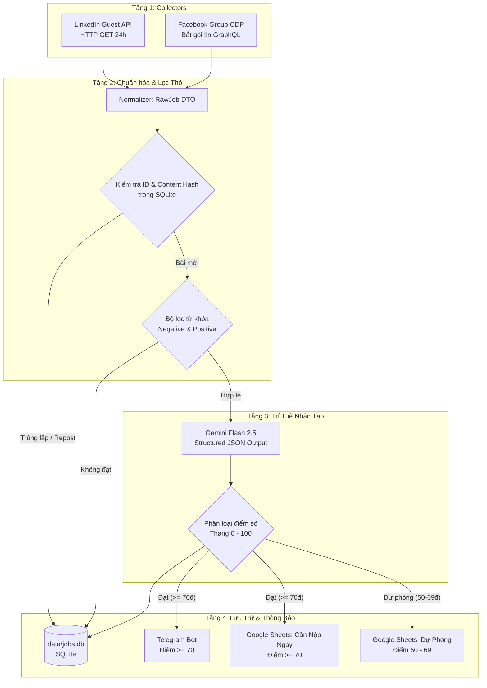

# 🏗️ JobHunter Bot — Kiến Trúc Hệ Thống & Hướng Dẫn Vận Hành

## 1. Giới thiệu Tổng quan

**JobHunter Bot** là hệ thống tự động thu thập, phân loại, khử trùng lặp và chấm điểm bài đăng tuyển dụng IT & Game Dev đa nền tảng (Facebook Groups, LinkedIn Jobs). 

Hệ thống được thiết kế theo triết lý:
- **Tối ưu chi phí:** Chi phí vận hành = $0 (sử dụng Gemini Flash Free Tier, SQLite, Google Sheets và HTTP APIs).
- **Chống khóa tài khoản (Anti-Checkpoint):** Không dùng cào DOM trực tiếp bằng Selenium ảo; thay vào đó sử dụng kết nối Chrome Remote Debugging (CDP) và lắng nghe gói tin ngầm GraphQL `/api/graphql/`.
- **Chống tin tuyển dụng ảo (Ghost Jobs):** Tự động phát hiện bài đăng bị spam/repost nhiều lần qua thời gian dài bằng cơ chế băm nội dung `MD5`.
- **Chấm điểm chất lượng bằng AI:** Trích xuất thông tin có cấu trúc (Structured Outputs JSON) và chấm điểm 0 - 100 theo 3 tiêu chí nghiêm ngặt.

---

## 2. Sơ đồ Kiến trúc Phễu Đa Tầng (Multi-Source Funnel)



---

## 3. Cấu trúc Thư mục

```text
job-hunter-bot/
├── chrome_profile/              # Thư mục lưu Session Profile Chrome phụ
├── data/
│   └── jobs.db                  # File SQLite lưu trữ duy nhất
├── src/
│   ├── config.py                # Quản lý API Key, từ khóa, URL Group
│   ├── db.py                    # Khởi tạo bảng, kiểm tra trùng, cập nhật SQLite
│   ├── collectors/
│   │   ├── base_collector.py    # Định nghĩa RawJob DTO và BaseCollector
│   │   ├── linkedin_api.py      # Thu thập LinkedIn qua HTTP Guest API
│   │   └── fb_cdp_listener.py   # Lắng nghe GraphQL Facebook qua Chrome CDP
│   ├── pipeline/
│   │   ├── pre_filter.py        # Lọc từ khóa thô & Băm nội dung MD5
│   │   └── ai_scorer.py         # Gọi Gemini trích xuất JSON & chấm điểm 0-100
│   ├── notifiers/
│   │   └── telegram_sheet.py    # Bắn tin Telegram và Webhook Google Sheets
│   ├── pre_filter.py            # Module re-export
│   ├── linkedin_api.py          # Module re-export
│   ├── fb_cdp_listener.py       # Module re-export
│   ├── ai_scorer.py             # Module re-export
│   ├── notifier.py              # Module re-export
│   └── main.py                  # Module chạy chính
├── start_chrome_debug.bat       # Mở Chrome thật cổng Debug 9222
├── google_apps_script.js        # Script Webhook đồng bộ Google Sheets
├── main.py                      # File chạy ở thư mục gốc
├── requirements.txt             # Thư viện Python
├── .env.example                 # Mẫu cấu hình biến môi trường
├── .env                         # Cấu hình môi trường thực tế
└── ARCHITECTURE.md              # Tài liệu kiến trúc
```

---

## 4. Chi tiết Kỹ thuật Từng Phân Hệ

### 4.1. LinkedIn Collector (`src/collectors/linkedin_api.py`)
- Sử dụng Guest Jobs API ẩn của LinkedIn:
  - Danh sách: `https://www.linkedin.com/jobs-guest/jobs/api/seeMoreJobPostings/search`
  - Chi tiết: `https://www.linkedin.com/jobs-guest/jobs/api/jobPosting/{job_id}`
- Không yêu cầu đăng nhập tài khoản.
- Lọc theo vị trí (mặc định: `Hanoi, Vietnam`), thời gian `f_TPR=r86400` (24 giờ qua), sắp xếp `sortBy=DD` (mới nhất).
- Kiểm tra trùng lặp `li_{job_id}` trong SQLite trước khi gọi lấy chi tiết bài đăng để tiết kiệm băng thông.

### 4.2. Facebook Group Interceptor (`src/collectors/fb_cdp_listener.py`)
- Chạy thông qua trình duyệt Chrome thật với cờ `--remote-debugging-port=9222` và thư mục dữ liệu tách biệt `chrome_profile/`.
- Playwright kết nối qua giao thức Chrome DevTools Protocol (`CDP`).
- Lắng nghe sự kiện mạng `/api/graphql/` và bóc tách đệ quy các đối tượng JSON chứa `post_id` và `message.text`.
- Không phụ thuộc vào class hay CSS selector của Facebook (vốn thay đổi liên tục).
- Cuộn trang với khoảng cách ngẫu nhiên và nhịp nghỉ (Human Jitter) từ 3.5s đến 7.5s.

### 4.3. Băm Nội Dung & Nhận Diện Ghost Job (`src/pipeline/pre_filter.py`)
- Làm sạch văn bản: Loại bỏ toàn bộ số (số điện thoại, ngày tháng thay đổi nhỏ), loại bỏ dấu câu, chuyển về chữ thường.
- Lấy 300 ký tự cốt lõi băm thành chuỗi `MD5`.
- Nếu bài đăng có cùng mã băm xuất hiện lại:
  - Tăng `repost_count += 1`.
  - Nếu `repost_count >= 4` và bài đã tồn tại trên 30 ngày: Gán nhãn `ghost_job` để cảnh báo tin tuyển dụng ảo.

### 4.4. Thang Điểm Thẩm Định AI (`src/pipeline/ai_scorer.py`)
Hệ thống sử dụng `gemini-2.5-flash` kèm Structured Outputs Pydantic Schema trên thang 100 điểm:
1. **Độ minh bạch (Tối đa 35đ):**
   - Tên công ty / studio rõ ràng: +15đ.
   - Mức lương cụ thể: +10đ (Thỏa thuận: 0đ).
   - Địa điểm & hình thức làm việc: +10đ.
2. **Độ uy tín người đăng (Tối đa 25đ):**
   - Tech Lead / PM / Dev tuyển trực tiếp hoặc email công ty: +25đ.
   - Headhunter / tuyển dụng trung gian / chỉ nhận inbox kín: +5đ.
3. **Độ khớp hồ sơ (Tối đa 40đ):**
   - Khớp công nghệ (Unity, C#, C++, Java, Node.js, SQL): +25đ.
   - Cấp bậc Intern / Fresher / Junior (< 2 năm KN): +15đ.
   - Yêu cầu Senior hoặc trái ngành: Trừ -30đ.

---

## 5. Hướng Dẫn Vận Hành

### Bước 1: Cài đặt thư viện
```powershell
pip install -r requirements.txt
```

### Bước 2: Điền cấu hình vào file `.env`
Mở file `.env` và điền:
- `GEMINI_API_KEY`: Lấy miễn phí tại [Google AI Studio](https://aistudio.google.com/)
- `TELEGRAM_BOT_TOKEN`: Token bot từ `@BotFather`
- `TELEGRAM_CHAT_ID`: ID người nhận từ `@userinfobot`
- `GOOGLE_SHEET_WEBHOOK`: (Tùy chọn) Link Webhook sau khi deploy `google_apps_script.js`

### Bước 3: Mở Chrome Debugging để cào Facebook
Nhấp đúp chuột vào file:
```cmd
start_chrome_debug.bat
```
Đăng nhập tài khoản Facebook phụ vào cửa sổ Chrome vừa mở ra (chỉ cần làm lần đầu tiên).

### Bước 4: Chạy Bot
- Chạy toàn bộ luồng (LinkedIn + Facebook):
  ```powershell
  python main.py
  ```
- Chỉ quét LinkedIn:
  ```powershell
  python main.py --source linkedin
  ```
- Chỉ quét Facebook Group:
  ```powershell
  python main.py --source facebook
  ```
- Kiểm tra kết nối AI:
  ```powershell
  python main.py --test-ai
  ```
- Xem thống kê bài viết trong cơ sở dữ liệu:
  ```powershell
  python main.py --stats
  ```
